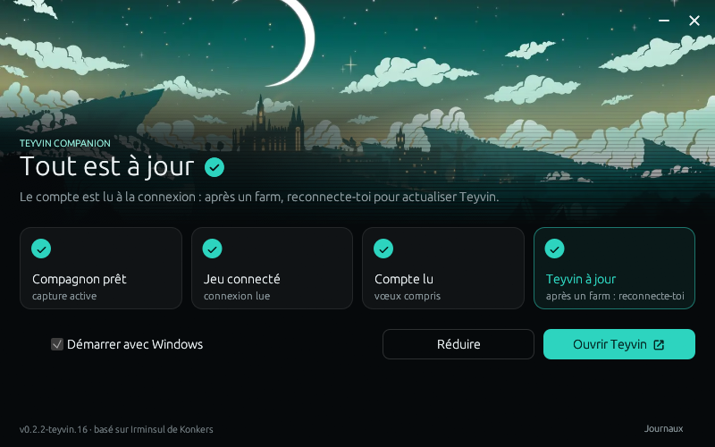

# Teyvin Companion

## [⬇ Télécharger Teyvin Companion (Windows)](https://github.com/kevinfern06/teyvin-compagnon/releases/latest/download/TeyvinCompanion.exe)

Le compagnon Windows de [Teyvin](https://teyvin.app) : lance-le avant Genshin Impact, et ton compte
Teyvin (persos, armes, artefacts, inventaire, historique de vœux) se met à jour tout seul. Plus de fichier à
exporter ni de lien à copier-coller.

## Comment ça marche

Teyvin Companion est [Irminsul](https://github.com/konkers/irminsul) de Konkers, sans changement, avec un petit
**relais local** en plus :

- Irminsul lit ton compte quand tu te connectes au jeu, comme d'habitude ;
- le relais garde le dernier export (format GOOD) et le lien de ton historique de vœux en mémoire, et les sert
  **uniquement sur ton ordinateur** (`127.0.0.1:47317`) ;
- le site Teyvin, ouvert dans ton navigateur, les y lit et se met à jour. Seul le site Teyvin a le droit de les
  lire ; rien n'est envoyé sur Internet.

Le moteur d'Irminsul (lecture du jeu, mises à jour) reste intact. On y ajoute le relais
([`teyvin/relay.rs`](teyvin/relay.rs)), on remplace son écran par celui du compagnon, aux couleurs de Teyvin
([`teyvin/app.rs`](teyvin/app.rs) : l'état en grand, quatre étapes, « Démarrer avec Windows », « Ouvrir Teyvin »),
et on modifie trois lignes ailleurs. Le tout est appliqué par [`teyvin/apply.py`](teyvin/apply.py).

## Installation

1. Télécharge `TeyvinCompanion.exe` dans les [releases](../../releases/latest).
2. Lance-le **avant** le jeu. Il demande les droits administrateur pour lire le trafic du jeu, comme Irminsul.
   Windows peut afficher un avertissement SmartScreen (programme non signé) : « Informations complémentaires »,
   puis « Exécuter quand même ».
3. La capture démarre toute seule. Coche « Démarrer avec Windows » pour ne plus avoir à y penser.
4. Ouvre Teyvin : la première fois, le navigateur peut te demander l'accès au réseau local. Accepte.

Le compagnon se met à jour tout seul, comme Irminsul.

## Suivre Irminsul

Chaque jour, une [GitHub Action](.github/workflows/build.yml) regarde si Irminsul a publié une nouvelle version.
Si oui, elle reprend son code, applique la modification Teyvin, compile le `.exe` et publie une release
`vX.Y.Z-teyvin.N`. Par sécurité, une **nouvelle version d'Irminsul part en brouillon** (avec une issue qui
prévient) : on relit ses changements avant de publier, puisque le compagnon se met à jour tout seul et tourne
en administrateur. Si la modification ne s'applique plus (Irminsul a changé aux endroits touchés), l'Action
échoue et il faut ajuster `teyvin/apply.py`.

## Crédits et licence

Tout le travail de lecture du jeu vient d'[Irminsul](https://github.com/konkers/irminsul) (© 2025 Erik Gilling,
licence MIT) et de ses bibliothèques. Ce dépôt ne contient que le relais et l'outillage, sous la même licence
MIT. Projet de fan non officiel, sans lien avec HoYoverse ni avec les auteurs d'Irminsul : merci de ne pas leur
signaler les problèmes du compagnon.
