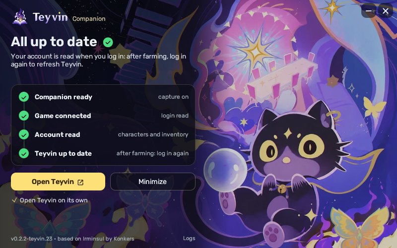

# Introduction

Teyvin Companion is a build of [Irminsul](https://github.com/konkers/irminsul) that shares its exports with
[Teyvin](https://teyvin.app), a Genshin Impact planner, instead of the clipboard or a file.

Irminsul's capture and export code is used unchanged. Teyvin Companion adds a small HTTP relay that serves the
latest GOOD export on `127.0.0.1:47317`. The relay only answers requests from the Teyvin website, and nothing is
sent over the network. Like Irminsul, it needs to run with admin privileges (for the packet capture) and to be
running when Genshin starts.

## Features

- Everything Irminsul exports: artifacts, weapons, materials and characters
- Local relay serving the latest export to the Teyvin website
- Simple window showing the current state of the capture and the relay

## Building

The `teyvin` folder contains the relay, the window and a script that applies them to an Irminsul source tree.
Releases are built from that tree with Irminsul's own build setup.

## Thanks

Teyvin Companion is built entirely on [Irminsul](https://github.com/konkers/irminsul) by Konkers and on the
projects it credits. Teyvin Companion is not affiliated with Irminsul: please don't report issues with it to
the Irminsul project.

## License

MIT, like Irminsul.
